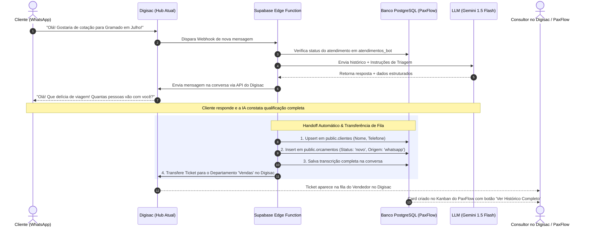

# 🚀 Plano Diretor de Implementação: Triagem Autônoma Soberana (Digisac + Instagram)

> **Módulo**: PaxFlow LeadBot™ — Atendimento, Qualificação Autônoma e Conversão em Orçamentos  
> **Filosofia**: Zero vazamento de dados, integração nativa com o Digisac existente e transparência total com o vendedor.

---

## 1. Visão Geral da Arquitetura Híbrida (WhatsApp via Digisac + Instagram Direto)

O ecossistema respeita as ferramentas consolidadas da agência:
1. **WhatsApp (via Digisac)**: O WhatsApp já conectado no Digisac recebe a mensagem. O Digisac notifica o PaxFlow via Webhook. A IA do PaxFlow responde pelo Digisac enquanto estiver em triagem. Ao qualificar, o PaxFlow transfere o ticket no Digisac para a fila dos vendedores e cria o orçamento no PaxFlow.
2. **Instagram (via Meta Graph API)**: Comentários e DMs do Instagram são recebidos diretamente pelo PaxFlow. A IA faz a triagem e captura o WhatsApp do lead.



---

## 2. Como Funciona a Entrada e Extração Invisível dos Dados

A experiência é desenhada para ser **zero atrito**: o cliente não preenche formulários, links externos ou menus engessados; ele apenas conversa naturalmente.

### A. Recepção do Payload Bruto (Webhook)
Quando o cliente manda mensagem, a Meta envia um evento HTTPS para a Edge Function:
- **WhatsApp**: Envia o número E.164 (`5511999998888`), timestamp e nome de perfil do WhatsApp.
- **Instagram**: Envia o IGSID da conta, @ e texto da DM ou comentário em publicação.

### B. Extração Semântica Progressiva (Parsing por IA)
A cada mensagem, a IA compara o histórico da conversa com a ficha técnica esperada e devolve um JSON invisível:
```json
{
  "nome": "Carlos Silva",
  "telefone": "5511999998888",
  "destino": "Cancun",
  "periodo_estimado": "Julho/2027",
  "quantidade_adultos": 2,
  "quantidade_criancas": 1,
  "idade_criancas": [7],
  "tem_flexibilidade": true,
  "dados_faltantes": []
}
```
Se ainda faltarem dados (ex: quantidade de pessoas), a IA formula a próxima pergunta natural em tom acolhedor.

### C. O Momento da Gravação no PaxFlow (Handoff Automático)
No momento em que `dados_faltantes` estiver vazio (ou seja, ficha mínima completa):
1. **Upsert em `public.clientes`**: Localiza pelo telefone/email. Se novo, cria a ficha; se existente, atualiza o histórico de interesse.
2. **Insert em `public.orcamentos`**:
   - Cria o card no funil Kanban com status `'novo'` e canal `origem = 'whatsapp'` ou `'instagram'`.
   - Gera um **Resumo Executivo** nas notas para o vendedor (ex: *"Lead qualificado: Casal com 1 filho de 7 anos querendo Cancun em Julho. Flexíveis com datas."*).
3. **Pausa Defensiva do Bot**: O registro em `atendimentos_bot` muda para `status = 'humano_assumiu'`, impedindo qualquer resposta automática futura.
4. **Alerta Instantâneo ao Vendedor**: Dispara notificação com som e badge no topo do PaxFlow com atalho de 1-clique para o consultor assumir a conversa no WhatsApp/Direct.

---

## 3. Estrutura de Banco de Dados Necessária (Supabase)

Para controlar o estado das conversas sem misturar rascunhos com dados oficiais, criamos apenas **uma tabela relacional dedicada**:

### Tabela: `public.atendimentos_bot`
```sql
CREATE TABLE IF NOT EXISTS public.atendimentos_bot (
    id UUID PRIMARY KEY DEFAULT gen_random_uuid(),
    canal TEXT NOT NULL CHECK (canal IN ('whatsapp', 'instagram')),
    identificador_cliente TEXT NOT NULL, -- Número E.164 no WhatsApp ou IGSID no Instagram
    nome_identificado TEXT,
    dados_coletados JSONB DEFAULT '{}'::jsonb, -- { destino, periodo, adultos, criancas, orcamento }
    historico_mensagens JSONB DEFAULT '[]'::jsonb, -- Últimas mensagens para manter o contexto
    status TEXT NOT NULL DEFAULT 'em_triagem' CHECK (status IN ('em_triagem', 'qualificado', 'humano_assumiu', 'arquivado')),
    orcamento_id UUID REFERENCES public.orcamentos(id) ON DELETE SET NULL,
    consultor_atribuido_id UUID REFERENCES public.perfis(id) ON DELETE SET NULL,
    created_at TIMESTAMPTZ DEFAULT NOW(),
    updated_at TIMESTAMPTZ DEFAULT NOW()
);

CREATE INDEX IF NOT EXISTS idx_atendimentos_bot_identificador ON public.atendimentos_bot(identificador_cliente);
CREATE INDEX IF NOT EXISTS idx_atendimentos_bot_status ON public.atendimentos_bot(status);
```

---

---

## 4. Matriz de Decisões de Negócio & Painel de Configurações

Para garantir autonomia total à gestão da agência, o módulo integrará uma aba dedicada em **Configurações -> Triagem & LeadBot**:

### A. Reconhecimento de Clientes Existentes
- **Regra de Ouro**: Se o telefone já estiver cadastrado em `public.clientes`:
  - **Com Viagem Ativa / Em Andamento**: O robô **NUNCA** responde. Transfere imediatamente para o consultor responsável pelo cliente/viagem sem atrito.
  - **Cliente Histórico (Sem viagem ativa)**: A IA reconhece o passageiro pelo primeiro nome (*"Olá, Juliana! Que bom ter você de volta! ✈️ Está planejando uma nova viagem?"*) e faz a triagem do novo destino com agilidade.

### B. Distribuição de Leads Qualificados (Configurável na Gestão)
A gestão poderá selecionar no painel de configurações a estratégia desejada:
1. **Roleta Balanceada (Round-Robin)**: Distribui equitativamente entre os consultores que estão marcados como ativos hoje na tabela de `escala`.
2. **Mesa Única (Fila Aberta)**: O orçamento cai na coluna "Novo" com tag `LeadBot` para qualquer vendedor puxar.
3. **Especialistas por Destino**: Regras por país/região (ex: Europa -> Consultor A; Nacional -> Consultor B).
4. **Fila do Gestor**: Encaminha para aprovação e triagem manual da gerência.

### C. Tratamento de Abandono de Triagem (Configurável na Gestão)
Caso o cliente pare de responder no meio das perguntas (ex: informou destino mas sumiu):
- **Opção A (Padrão Silencioso)**: Envia 1 lembrete gentil após 2 horas (*"Ficou alguma dúvida sobre sua viagem?"*). Se não responder em 24h, arquiva em `atendimentos_bot` sem poluir o Kanban.
- **Opção B (Lead Incompleto no Kanban)**: Cria o cartão em `orcamentos` com a tag `⚠️ Incompleto / Resgate` para o vendedor tentar contato ativo.

### D. Áudios no WhatsApp (Multimodal Nativo)
- O WhatsApp Cloud API entrega o arquivo de áudio (`.ogg`/`.opus`).
- A Edge Function envia o binário diretamente para a API Multimodal do Gemini 1.5 Flash.
- A IA escuta, transcreve e extrai os dados sem o cliente perceber a diferença, respondendo amigavelmente em texto.

### E. Comentários em Posts do Instagram (Engajamento + Privado)
- **Resposta Pública no Post**: A IA posta um comentário na publicação (ex: *"Acabamos de te mandar todas as informações no Direct! ✈️✨"*), aumentando o alcance orgânico do post.
- **Abertura Imediata de DM**: Inicia a conversa privada com o cliente no Direct para colher os dados e o WhatsApp dele.

### F. Atendimento Noturno e Fora do Horário Comercial
- A IA funciona 24 horas por dia, 7 dias por semana.
- Se o atendimento ocorrer fora da escala de trabalho, a IA acolhe o cliente normalmente, extrai todas as informações e finaliza:
  > *"Perfeito! Registrei todos os detalhes da sua viagem. Como nosso time comercial já encerrou o expediente hoje, nosso consultor especialista vai entrar em contato com você logo às 08h30 de amanhã com as melhores opções! Tenha uma ótima noite!"*

---

---

## 5. Aceleradores de Conversão & Inteligência Comercial (Vendas de Alta Performance)

Além da triagem técnica básica, o módulo incorpora 4 recursos estratégicos para maximizar a taxa de fechamento dos vendedores:

### A. "Cheat Sheet" do Vendedor (Perfil Psicológico de Compra)
Ao qualificar o lead, a IA analisa as entrelinhas da conversa e grava no orçamento um bloco de inteligência comercial:
- **Sensibilidade a Preço**: Identifica se o cliente busca "o menor custo / flexível com escalas" ou se prioriza "conforto / voos diretos / resorts centrais".
- **Ocasião da Viagem**: Identifica motivações afetivas (Lua de Mel, Aniversário de Casamento, Férias com Filhos, Viagem com Amigos).
- **Alerta de Objeções**: Se o cliente comentou sobre experiências ruins anteriores (ex: conexões perdidas, cancelamentos), o sistema emite um alerta em destaque para o vendedor oferecer produtos consolidados e apólices de seguro com coberturas ampliadas.

### B. Integração com o PaxFlow Studio™ (Proposta Relâmpago)
- Assim que o destino e o perfil são consolidados, o backend pré-cria um rascunho de proposta digital interativa no **PaxFlow Studio™** com imagens em alta definição do Unsplash e o template visual do destino.
- Ao abrir o ticket no Digisac, o vendedor já tem o link do rascunho no PaxFlow, precisando apenas inserir os valores finais dos fornecedores e disparar a proposta visual de luxo em minutos.

### C. "Warm Handoff" com Identidade Real do Consultor
- A IA consulta a escala do dia (`public.escala`) e identifica o consultor ativo responsável pela rodada.
- Na despedida da triagem, humaniza a passagem:
  > *"Excelente, [Nome]! Já estruturei seu pedido aqui. O **[Nome do Consultor]** é o nosso especialista nesse destino e vai assumir sua conversa agora mesmo pelo Digisac para te apresentar as opções oficiais!"*

### D. Rastreamento de Campanhas (Meta Ads Attribution)
- O webhook captura os metadados do nó `referral` (anúncios *Click-to-WhatsApp* e campanhas do Instagram).
- O campo `origem` do orçamento registra o nome/ID exato do anúncio que originou a conversa, permitindo à gestão cruzar o investimento de tráfego pago diretamente com as vendas faturadas no PaxFlow.

### E. Recuperador de Orçamentos com Follow-Up Amigável (Reativação de Vendas)
- Quando o vendedor envia a proposta no Digisac e arrasta o card no PaxFlow para a coluna *"Proposta Enviada"*, o sistema monitora a inatividade do cliente.
- Caso o lead fique 48h sem responder, o PaxFlow agenda ou dispara via Digisac um toque gentil e profissional:
  > *"Oi, [Nome]! Tudo bem? Passando para saber se conseguiu dar uma olhadinha na proposta que o [Nome do Consultor] preparou para vocês. As tarifas aéreas e bloqueios de hotel oscilam com frequência, me avisa se quiser ajustar algo!"*
- Reativa de 15% a 25% dos orçamentos estagnados sem sobrecarregar a memória do consultor.

### F. Checagem Sanitária e Documental Pré-Venda (PaxFlow Risk Score™ na Triagem)
- A IA cruza o destino informado com a base de inteligência do **PaxFlow Risk Score™**:
  - Se for **EUA**: Pergunta amigavelmente se os viajantes já possuem o Visto Americano (B1/B2/ESTA).
  - Se for **Europa (Espaço Schengen)**: Registra no card a obrigatoriedade do Seguro Viagem de 30.000€ e validade do passaporte > 3 meses além da estadia.
  - Se for destino com exigência de **CIVP (Febre Amarela)** ou **Mercosul** (RG com menos de 10 anos, alertando que CNH não é aceita): A IA já antecipa o requisito na triagem.
- Previne que o consultor perca tempo cotando itinerários complexos para destinos onde o cliente não tem a documentação obrigatória em dia.

---

## 6. As 4 Fases do Plano de Execução

### Fase 1: Fundação & Homologação na Meta (Semana 1)
- [ ] Cadastro do aplicativo da agência no portal *Meta for Developers* (Tipo: Business).
- [ ] Ativação do produto **WhatsApp** e associação do número de telefone.
- [ ] Configuração do Webhook da Meta apontando para a URL temporária ou de homologação.
- [ ] Teste de envio e recebimento de "Hello World" via cURL e Postman.

### Fase 2: O Cérebro da Triagem (Supabase Edge Function + IA) (Semana 2)
- [ ] Desenvolvimento da Edge Function `meta-webhook`:
  - Validação do token de verificação da Meta (`hub.verify_token`).
  - Tratamento de mensagens de texto recebidas.
- [ ] Engenharia de Prompt (System Prompt da Agência):
  - Definição do comportamento do bot: gentil, objetivo, focado em turismo, sem inventar preços fictícios nem prometer reservas.
  - Formato estrito de saída em JSON para a função saber quando o lead cruzou a linha de "Qualificado".
- [ ] Trava de Contexto: Manter apenas as últimas 6 mensagens no histórico para economizar tokens e evitar confusão de memória.

### Fase 3: Conexão Nativa com o PaxFlow (Handoff) (Semana 3)
- [ ] Rotina de conversão automática no banco:
  - Verificar se o telefone já existe na tabela `clientes` (evita duplicar passageiros já conhecidos).
  - Criar o cartão no Kanban de `orcamentos` com rótulo "Lead IA", notas resumidas da viagem e canal de origem (`origem = 'whatsapp'`).
  - Aplicar a roleta de consultores ou vincular ao plantonista do dia da tabela de `escala`.
- [ ] Trava de Interrupção Humana:
  - Botão no card do orçamento ou na tabela de viagens: **"Assumir Atendimento"** (desativa a IA permanentemente para aquela conversa).

### Fase 4: Piloto Controlado & Ajustes Finos (Semana 4)
- [ ] Testes internos com números dos próprios donos e colaboradores simulando clientes confusos, clientes diretos e mensagens de áudio (transcrição se necessário).
- [ ] Lançamento em horário comercial com supervisão em tempo real.
- [ ] Validação do feedback dos consultores comerciais e ajuste no tom de voz.

---

## 7. Governança e Regras de Segurança Operacional

1. **Sem Alucinação de Preços**: A IA é terminantemente instruída a **NUNCA inventar valores de passagens aéreas ou pacotes**, pois os preços mudam por minuto no turismo. A resposta padrão para valores é:
   > *"Nossos valores mudam conforme a disponibilidade e data exata! Estou coletando seus detalhes justamente para o nosso consultor te passar a cotação oficial sem surpresas."*
2. **Fail-Safe para Humano a Qualquer Momento**: Se o cliente digitar frases como *"falar com atendente"*, *"quero falar com alguém"* ou *"humano"*, a IA reconhece imediatamente e transfere na hora sem insistir em perguntas.
3. **Privacidade Absoluta (LGPD)**: Nenhuma mensagem é compartilhada com ferramentas de terceiros; tudo repousa no banco de dados isolado da própria agência no Supabase.

---

## 8. Próximos Passos
Este documento serve como a bíblia de referência do projeto. Assim que a agência validar os itens do artefato `01_pre_requisitos_automacao_meta.md`, podemos iniciar os primeiros scripts de migração de banco e a Edge Function piloto.

