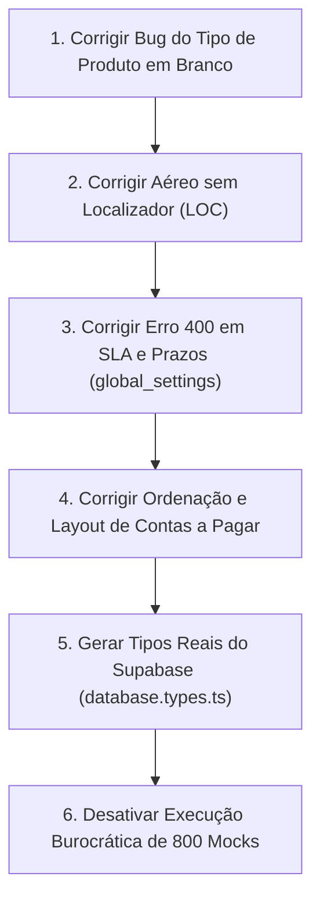

# Plano Estratégico: Dados Reais, Sistema Real e Resolução de Falhas

> **Premissa Fundamental do PaxFlow**:
> *"Não quero mocks, fallbacks ou zero-drift. Dados reais, sistema real, uso real."*

---

## 1. Diagnóstico do Problema Atual

- **Falsa Sensação de Segurança**: O projeto acumulou quase 800 testes automatizados rodando em memória (*mocks*). Embora dessem "100% verde" no terminal, eles não testavam o comportamento real do navegador (restrições de CORS e requisições HTTP reais) nem a integridade física das tabelas do Supabase (onde colunas inexistentes causavam erro 400 imediato em produção).
- **Cansaço Operacional e Sobrecarga de Tokens**: A obrigação de executar toda a suíte de quase 800 testes a cada alteração pontual tornou o ciclo de desenvolvimento lento, exaustivo e ineficaz para prevenir falhas reais de uso.
- **Divergência entre Código e Banco**: Modificações no código TypeScript adicionando campos que ainda não haviam sido executados no banco real geraram telas quebradas e inconsistências.

---

## 2. Fila Imediata de Correção de Bugs Reais (Prioridade Total)

Antes de qualquer modificação ou reorganização na infraestrutura de testes, o foco absoluto é resolver as falhas reais apontadas pelos operadores e pelo dono do produto:

### 🔴 Item 01: Seletor de "Tipo de Produto" em Branco no Cadastro de Viagem
- **Problema**: Ao abrir o formulário para adicionar produto em uma viagem, a lista suspensa de "Tipo" aparece vazia ("Selecione o tipo..."), impedindo o cadastro.
- **Causa Raiz**: O componente depende de consulta assíncrona ou de tabela que não entrega os tipos padrão imediatos.
- **Ação**: Garantir catálogo real estrito, carregamento transparente e fail-fast com os tipos oficiais do sistema (Aéreo, Hotel, Transfer, Seguro, etc.).

### 🔴 Item 02: Itens de Aéreo sem Código Localizador (LOC)
- **Problema**: Itens de voo (por exemplo: voos de volta de Florianópolis) estão sendo exibidos nas listagens operacionais sem o código localizador correspondente.
- **Causa Raiz**: Vínculo entre produtos da viagem, localizadores associados e tabela de conferência/segmentos que não herda o código principal quando há múltiplos trechos (ida e volta).
- **Ação**: Investigar e corrigir a persistência e associação do localizador no particionamento de produtos aéreos.

### 🔴 Item 03: Erro 400 ao Salvar Configurações de SLA e Prazos
- **Problema**: Ao tentar salvar parâmetros na aba de SLA e Prazos em Configurações, o Supabase responde com `status 400` na tabela `global_settings` (`id=eq.67b19d30...`).
- **Causa Raiz**: Envio de payload contendo colunas que não existem fisicamente na tabela `global_settings` do banco de produção, ou incompatibilidade de tipos de dados nos campos de automação de prazos.
- **Ação**: Mapear as colunas exatas da tabela `global_settings` no banco real e ajustar o payload de salvamento para conter estritamente as colunas físicas válidas.

### 🔴 Item 04: Contas a Pagar — Ordenação Invertida, Cabeçalhos Clicáveis e Tabela
- **Problema**:
  1. A ordenação padrão dos itens veio invertida.
  2. Falta de ordenação dinâmica ao clicar no título das colunas da tabela.
  3. A tabela está ultrapassando os limites da tela em notebooks e telas menores (1366x768).
- **Ação**:
  1. Corrigir a ordenação padrão por data de vencimento/criação.
  2. Implementar função de ordenação unificada ao clicar nas colunas (`sortData`).
  3. Aplicar o invólucro responsivo obrigatório PaxFlow (`overflow-x-auto custom-scrollbar min-w-[...]`).

---

## 3. Diretrizes Arquiteturais para o Novo Modelo (Pós-Bugs)

Assim que as falhas acima forem solucionadas, a engenharia do PaxFlow adotará as seguintes regras estritas:

### A. Tipagem Oficial do Banco Real (`database.types.ts`)
- O schema oficial do Supabase em produção será extraído via comando oficial do Supabase CLI:
  ```bash
  npx supabase gen types typescript --project-id fscfmnqcqioqiibvzhub > src/types/database.types.ts
  ```
- O cliente do Supabase (`src/services/supabase.ts`) será tipado com `<Database>`.
- **Efeito Prático**: Se qualquer consulta tentar buscar ou salvar uma coluna inexistente no banco real, **o código não compila**. O compilador TypeScript atuará como o fiscal definitivo de integridade, eliminando erros 400 antes de qualquer deploy.

### B. Proibição Total de Fallbacks Silenciosos (*Padrão Fail-Fast*)
- Nunca esconder erros de banco nem empacotar campos novos em campos genéricos ou JSONs sem coluna física oficial.
- Se o banco de dados não contiver uma tabela ou coluna oficial, o sistema emite aviso claro e transparente de schema desatualizado para o operador.

### C. Fim da Burocracia de Testes Ilusórios
- Descontinuação da obrigatoriedade de rodar os 800 testes mockados a cada commit ou alteração pontual.
- Testes só serão executados ou mantidos se validarem regras de negócio reais, sem depender de mocks que mascaram o comportamento do navegador ou do banco.
- O critério de entrega passa a ser: **Código compilado limpo contra o schema real + fluxo de negócio testado com dados reais**.

---

## 4. Ordem de Execução Recomendada



