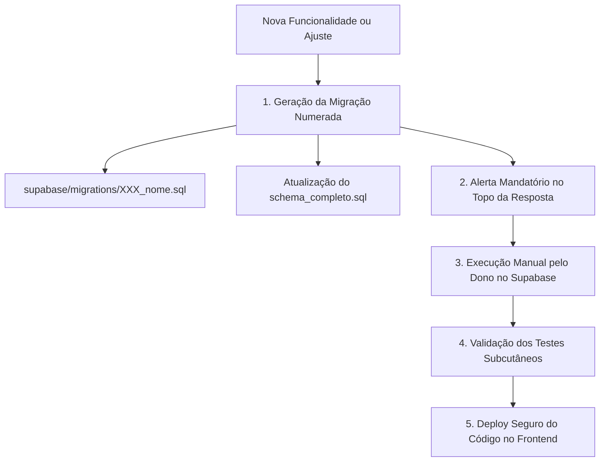

# 🏛️ Plano Diretor: Eliminação do Zero-Drift & Nova Governança Estrita de Banco de Dados

## 1. Contexto e Motivação Estratégica

O padrão anterior de **Zero-Drift** (tolerância a divergências de schema de banco no cliente) foi originalmente concebido para evitar que a aplicação exibisse erros de tela caso o frontend fosse atualizado antes da execução de scripts SQL no Supabase.

No entanto, em uma operação de agência de viagens no mundo real (com dinheiro, regras contábeis, faturamento e equipes de atendimento), esse padrão demonstrou causar **efeitos colaterais graves**:
1. **Mascaramento de Falhas Contábeis**: Quando o banco rejeita uma coluna nova (código `42703`) e a aplicação simula sucesso gravando o dado como texto solto dentro de `observacoes`, o sistema gera uma falsa sensação de integridade. Relatórios, gráficos de faturamento e consultas relacionais não conseguem apurar esses dados, gerando furos contábeis silenciosos.
2. **Complexidade Excessiva de Código**: Serviços inchados com múltiplos blocos `try/catch`, validações repetitivas de códigos `42703`/`42P01`, payloads duplicados e testes artificiais que aumentavam a lentidão da aplicação.
3. **Descentralização dos Dados**: Dificuldade para auditoria externa e migrações de dados devido à dispersão de informações estruturadas em campos textuais genéricos.

### 1.1. Nova Premissa Mandatória do PaxFlow
* **O Banco de Dados é a Única Fonte da Verdade Estruturada**: Dados de negócio, comissões, taxas, status e anexos devem residir exclusivamente em colunas e tabelas relacionais do PostgreSQL.
* **Governança Humana Estrita (Zero Execução Automática)**: Toda e qualquer alteração de infraestrutura de banco de dados (DDL) é executada **manualmente e exclusivamente pelo dono do produto no SQL Editor do Supabase antes de realizar o deploy do código**.
* **Falha Explícita e Transparente (Fim do Sucesso Falso)**: Se o código for publicado acidentalmente antes da execução do script SQL, o sistema não deve engolir o erro nem mutilar os dados. Ele deve exibir um alerta amigável e claro ao operador e interromper a gravação com segurança.

---

## 2. Pilares da Nova Arquitetura de Governança



### 2.1. Organização das Migrações no Repositório
* **Diretório Central**: Todas as migrações serão versionadas em `supabase/migrations/` com prefixo numérico sequencial de três dígitos:
  * Exemplo: `supabase/migrations/001_tabelas_iniciais.sql`
  * Exemplo: `supabase/migrations/002_financeiro_contas_pagar.sql`
  * Exemplo: `supabase/migrations/003_rateio_rav_viagens.sql`
* **Arquivo Mestre Consolidado**: Um arquivo cumulativo `supabase/schema_completo.sql` será mantido e atualizado continuamente, contendo todo o DDL da versão vigente para provisionamento rápido de novos ambientes.
* **Protocolo de Resposta ao Dono**: Sempre que uma alteração exigir DDL, o bloco SQL completo e mastigado deve ser exibido obrigatoriamente no topo da mensagem para cópia e execução imediata.

### 2.2. Tratamento Unificado de Erros de Schema (Tratamento Global)
Em vez de cada serviço individual ter dezenas de linhas capturando `42703` e criando fallbacks improvisados, adotaremos um interceptor/tradutor padronizado:
* **Detecção Centralizada**:
  ```ts
  // Exemplo conceitual do tradutor de erro de schema
  export function isSchemaDriftError(error: any): boolean {
    if (!error) return false;
    const code = error.code || '';
    const msg = error.message || '';
    return code === '42703' || code === '42P01' || msg.includes('does not exist') || msg.includes('schema cache');
  }
  ```
* **Comportamento na Interface**:
  - Exibe toast ou modal de aviso transparente: 
    > *"⚠️ Atualização de Banco Pendente: Esta funcionalidade exige uma atualização no banco de dados. Favor solicitar ao administrador a execução do script SQL correspondente no Supabase."*
  - **Não grava dados parciais**: Interrompe a persistência para garantir que nenhum lançamento financeiro ou operacional fique corrompido ou órfão.

---

## 3. Roteiro de Expurgo Gradual do Código Legado

O expurgo dos fallbacks defensivos e a simplificação dos serviços será executado **em paralelo com a otimização de desempenho dos módulos do ranking de lentidão**, garantindo estabilidade e testes 100% verdes a cada etapa:

| Etapa | Módulo Alvo | Ações de Expurgo do Zero-Drift | Dependência de Migração |
| :---: | :--- | :--- | :--- |
| **Fase 1** | **Central de Relatórios & Financeiro** | • Remoção de fallbacks em `viagens_divisoes`, `contato_realizado` e DDL de contas a pagar.<br>• Consultas diretas e limpas sem queries alternativas. | Script de conferência das colunas vigentes (`percentual_rav`, `banco_nome`). |
| **Fase 2** | **Inbox & Central de Alertas (Plano 2)** | • Expurgo de queries em bloco para simular junções com `orcamentos`, `viagens` e `clientes`.<br>• Consulta indexada direta de passaportes. | Nenhuma (apenas consultas nativas). |
| **Fase 3** | **Orçamentos & Kanban (Plano 4)** | • Remoção de fallback de `descricao` e `contato_realizado` em `orcamentosService.ts`.<br>• Persistência relacional pura sem injeção em textos soltos. | Validação da coluna `contato_realizado` na tabela `orcamentos`. |
| **Fase 4** | **Central de Reembolsos (Plano 6)** | • Limpeza de queries de caça a viagens órfãs sem protocolo.<br>• Relações estritas entre `viagens`, `produtos_viagem` e `reembolsos`. | Nenhuma. |
| **Fase 5** | **Documentos & Anexos (`anexosService.ts`)** | • **Fim do fallback em `viagens.observacoes`**: Toda gravação de arquivo deve residir exclusivamente na tabela `documentos_anexos`.<br>• Script de saneamento para migrar eventuais anexos antigos gravados em texto para a tabela oficial. | Tabela `documentos_anexos` e storage ativos. |
| **Fase 6** | **Conciliação Bancária (`conciliacaoService.ts`)** | • Remoção de checagens manuais de `banco_origem` e `banco_nome`.<br>• Estrutura definitiva para `extratos_bancarios_lotes` e `extratos_bancarios_transacoes`. | Coluna `banco_nome` consolidada. |

---

## 4. Script Inicial de Saneamento & Validação do Schema

Antes de iniciar o expurgo no código, o dono do produto executará um script SQL único de alinhamento no Supabase, garantindo que todas as colunas que antes causavam drift passem a existir de forma definitiva e homogênea no banco:

```sql
-- SCRIPT DE HOMOGENEIZAÇÃO PREVENTIVA (RODAR NO SUPABASE SQL EDITOR)

-- 1. Garantir colunas de Rateio de RAV em Viagens Divisões
ALTER TABLE IF EXISTS public.viagens_divisoes 
ADD COLUMN IF NOT EXISTS percentual_rav NUMERIC DEFAULT 0;

-- 2. Garantir colunas de Contato de Desistência em Orçamentos
ALTER TABLE IF EXISTS public.orcamentos 
ADD COLUMN IF NOT EXISTS contato_realizado BOOLEAN DEFAULT FALSE,
ADD COLUMN IF NOT EXISTS contato_realizado_em TIMESTAMPTZ,
ADD COLUMN IF NOT EXISTS contato_realizado_por UUID REFERENCES public.profiles(id);

-- 3. Garantir coluna de Banco no Lote de Extratos da Conciliação
ALTER TABLE IF EXISTS public.extratos_bancarios_lotes 
ADD COLUMN IF NOT EXISTS banco_nome TEXT;

-- 4. Garantir colunas de auditoria de embarques em viagens
ALTER TABLE IF EXISTS public.viagens 
ADD COLUMN IF NOT EXISTS contatos_embarque JSONB DEFAULT '[]'::jsonb;
```

---

## 5. Critérios de Sucesso e Garantia de Qualidade

1. **Zero Degradação Silenciosa**: Nenhum serviço do PaxFlow deve tentar mascarar erros de banco gravando dados contábeis em campos de observação.
2. **Código Enxuto e Rápido**: Redução de aproximadamente 15% a 25% no volume de código de serviços como `anexosService.ts`, `orcamentosService.ts` e `conciliacaoService.ts`.
3. **Mensagens Claras ao Operador**: Em caso de divergência de schema decorrente de deploy descompassado, o operador recebe orientação transparente e o banco permanece íntegro.
4. **Testes Subcutâneos 100% Conformes**: Substituição dos testes que forçavam simulação de erro `42703` por testes que validam a integridade relacional estrita e a interceptação amigável de erro.

---
*Plano Diretor salvo em `docs/plano_eliminacao_zero_drift_governanca_banco.md` como diretriz arquitetural oficial do PaxFlow.*

