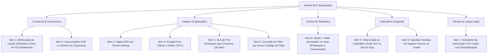

# Plano Arquitetural: Pacote de Evoluções e Melhorias Operacionais

> **Status:** Aguardando Aprovação do Usuário  
> **Origem:** Pacote de 9 Solicitações da Gestão  
> **Refinamento:** Alinhado integralmente via rodadas interativas de *Grill-me*  

---

## 1. Visão Geral e Objetivos

Este plano consolida as diretrizes técnicas e operacionais para a implementação do pacote de 9 melhorias solicitadas pela gestão da agência. Todas as definições foram refinadas para garantir zero regressão, conformidade estrita de banco de dados (PostgreSQL/Supabase) e preservação do padrão visual PaxFlow (h-[42px], rounded-xl, design tokens).



---

## 2. Detalhamento Técnico das 9 Entregas

### Item 1: Orçamentos Unificados em "Em Andamento" (Eliminação de Solicitado)
- **Eliminação da Coluna Solicitado**: A coluna `Solicitado` é removida por completo do Kanban. O fluxo passa a ser composto por 3 colunas ativas:
  1. ⏳ **Em Andamento** (ponto de entrada padrão de todo novo orçamento);
  2. 📤 **Aguardando** (proposta enviada ao cliente, aguardando aprovação);
  3. 🏆 **Concluído** (Venda Fechada ou Desistência).
- **Tela Unificada de Novo Orçamento**: Ao clicar em `+ Novo Orçamento`, abre-se um modal completo integrando os dados cadastrais do lead e os campos operacionais de negociação:
  1. *Identificação do Cliente*: Nome Completo com busca e autocomplete resiliente (reconhecendo clientes já existentes e exibindo badge de cliente cadastrado), Telefone, E-mail, Origem do Lead e Consultor Responsável.
  2. *Destino e Prazos*: Destino da Viagem (com suporte a autocomplete IATA do Item 2) e Data Estimada.
  3. *Dados Comerciais e Proposta*:
     - **Valor Estimado da Proposta (R$)**: Campo com máscara monetária brasileira para registrar a expectativa orçamentária do cliente ou valor preliminar.
     - **Temperatura do Lead**: Normal (50%), Quente (Alta chance) ou Frio (Baixa chance).
     - **Resumo e Anotações da Negociação (Área Ampliada)**: Campo de texto expandido e confortável (`rows="5"`, `min-h-[120px]`) para que os consultores anotem detalhadamente todo o briefing, exigências de voo, categorias de cabine/hotel e preferências do passageiro.
     - **Anexo de Arquivos / Documentos**: Upload direto de PDFs, imagens e propostas com armazenamento seguro no Google Drive.
     - **Tags**: Palavras-chave livres para categorização (ex: *Casal*, *Luxo*, *Cruzeiro*, *Milhas*).
- **Ações de Fechamento do Modal**:
  - `[ Cancelar ]`: Fecha o modal sem salvar.
  - `[ 💾 Salvar Orçamento ]`: Grava o orçamento com `status = 'EM_ANDAMENTO'`, gerando o card na coluna "Em Andamento" e fechando o modal.
  - `[ ✨ Salvar e Abrir Studio™ ]`: Grava o orçamento e abre imediatamente a interface de montagem visual de propostas do Studio™.
- **Métricas e Cronômetro de SLA**: O cronômetro de primeiro atendimento é adaptado para medir o tempo decorrido da **criação da cotação (já em Em Andamento) até o envio formal da proposta** (`PROPOSTA_ENVIADA` / avanço para *Aguardando*).
- **Arquivos Afetados**: `src/pages/Orcamentos.ts`, `src/services/orcamentosService.ts`, `src/types/index.ts`, `src/controllers/orcamentosController.ts`.

---

### Item 2: Suporte a Siglas IATA em Viagens e Orçamentos
- **Regra de Negócio**:
  1. **Nos Trechos Aéreos de Viagens**: Campos `Origem` e `Destino` com autocomplete reativo baseado no catálogo IATA já existente no PaxFlow (ex: digitar `GRU` ➔ sugere `São Paulo - Guarulhos (GRU)`).
  2. **Flexibilidade Preservada**: Aceita tanto o código IATA de 3 letras quanto digitação livre de cidades sem aeroporto (destinos rodoviários, hotéis e portos).
  3. **No Destino de Orçamentos**: O campo de busca de destino passa a reconhecer siglas IATA (ex: digitar `MCO` preenche automaticamente `Orlando (MCO), Estados Unidos`).
- **Arquivos Afetados**: `src/components/dashboard/EditTravelModal.ts`, `src/pages/Orcamentos.ts`, `src/components/DestinosAutocomplete.ts`.

---

### Item 3: Rodapé Fixo (*Sticky Footer*) no Modal de Viagem
- **Regra de Negócio**: O botão `[ Salvar Alterações ]` e `[ Cancelar ]` deixa de ficar soterrado no final da aba "Dados Gerais". Ele passa a residir em uma barra inferior fixa (`sticky bottom-0 bg-white/95 backdrop-blur dark:bg-slate-900/95 border-t border-slate-100 dark:border-slate-800`), visível instantaneamente em qualquer rolagem.
- **Atalho Seguro**: Implementação do atalho `Ctrl + S` / `Cmd + S` com interrupção do evento do navegador (`e.preventDefault()`), ativado exclusivamente quando o modal estiver aberto em primeiro plano.
- **Arquivos Afetados**: `src/components/dashboard/EditTravelModal.ts`.

---

### Item 4: SLA de Pré-Embarque Diferenciado para Cruzeiros/Navio (20 Dias)
- **Regra de Negócio**:
  1. Criação do parâmetro `sla_cruzeiro_pre_embarque_dias INTEGER DEFAULT 20` na tabela `global_settings`.
  2. Interface de ajuste em *Configurações ➔ SLAs & Automações*.
  3. No motor do Inbox (`inboxService.ts`), quando a viagem possuir produto com categoria `cruzeiro`, `navio` ou `maritimo`, a janela de disparo do alerta é calculada com base neste parâmetro (padrão 20 dias), enquanto viagens aéreas convencionais seguem os 7 dias padrão.
  4. Formato de card enxuto mantido conforme solicitado.
- **Arquivos Afetados**: `supabase/schema.sql`, `src/pages/Configuracoes.ts`, `src/services/inboxService.ts`.

---

### Item 5: Correção do Filtro Avançado "Por Anexo" & Badge de Clipe
- **Diagnóstico Técnico**: O filtro avançado no `DashboardFilterEngine.ts` verificava `v.anexos_count`, porém a consulta principal de viagens em `Dashboard.ts` não trazia a agregação da tabela `documentos_anexos`.
- **Solução Arquitetural**:
  1. Realizar subconsulta agregada leve no carregamento do Dashboard (`documentos_anexos` indexada por `viagem_id`), computando `anexos_count` em memória sem transferir arquivos pesados.
  2. Ajustar o filtro para considerar "Com Anexo" viagens com `anexos_count > 0` OU com voucher emitido no produto.
  3. Inserir badge visual discreto com ícone de clipe (`📎`) na coluna Destino/Produtos quando houver anexos.
- **Arquivos Afetados**: `src/pages/Dashboard.ts`, `src/components/dashboard/ViagensTableView.ts`, `src/components/dashboard/DashboardFilterEngine.ts`.

---

### Item 6: Visão Dupla no Calendário (Ação Operacional vs. Data do Voo)
- **Regra de Negócio**: O calendário passa a adotar a **Visão Dupla Inteligente**:
  1. **Ação Operacional de SLA**: Na data correspondente à janela de SLA (ex: 7 dias antes para voos, 20 dias antes para cruzeiros), plota o card de tarefa `📞 Ação Pré-Embarque: [Cliente] - [Destino]`.
  2. **Data do Voo Real**: No dia em que a viagem de fato ocorre (`data_ida`), plota o card de evento `✈️ Embarque: [Cliente] - [Destino]`.
- **Arquivos Afetados**: `src/components/inbox/CalendarView.ts`, `src/services/inboxService.ts`.

---

### Item 7: Carga Única de Clientes Históricos do Leady (Script de Ingestão & SQL)
- **Decisão Operacional**: Conforme alinhamento via `/grill-me`, **não** será desenvolvida funcionalidade de tela ou assistente no sistema, pois trata-se de uma carga pontual e definitiva (one-off) de encerramento do Leady.
- **Volume e Origem dos Dados**:
  - 3 arquivos CSV consolidados cobrindo 01/08/2020 até 30/09/2026 (total de **2.824 linhas brutas**, resultando em aproximadamente **2.044 clientes únicos**).
  - 12 consultores do Leady identificados: `Alice Maciel`, `Cadu`, `Diego Gois`, `Fabiano Demarco`, `Guto`, `Malta`, `Maria`, `Marinna Morena`, `Paulo Soares`, `Rafael Sousa`, `Renata Martins`, `Sandra Varela`.
- **Regras de Negócio e Ingestão Alinhadas**:
  1. **Chave de Desduplicação e Precedência Temporal**:
     - CPF/CNPJ limpo (apenas dígitos) é a chave primária de identificação. Para registros sem documento, utiliza-se a combinação Nome + Telefone/E-mail.
     - Como clientes compram em períodos sucessivos (2020-2021, 2022-2023, 2024-2026), o registro do período mais recente possui precedência para atualizar e-mail, telefones e consultor responsável.
  2. **Tratamento de Conflito com Clientes Já Existentes (`COALESCE`)**:
     - Para clientes que já existirem na base do PaxFlow (mesmo CPF ou e-mail), aplica-se atualização defensiva: preserva todos os dados atuais do PaxFlow e preenche apenas os campos que estiverem vazios (`NULL` ou em branco).
  3. **Vínculo de Consultores (De-Para)**:
     - Mapeamento direto dos nomes do Leady para os perfis correspondentes na tabela `profiles`.
     - Consultores inativos ou sem cadastro equivalente no PaxFlow recebem `consultor_responsavel_id = NULL` (atribuídos à carteira Geral / Agência).
  4. **Preservação do Histórico Comercial do Leady**:
     - As métricas de valor do Leady (Primeira Compra, Última Compra, Rentabilidade, Ticket Médio, Total de Atendimentos Fechados) são agregadas e formatadas no campo `observacoes` do cliente (ex: `[Histórico Leady] Última Compra: 2024-05-10 | Ticket Médio: R$ 8.500 | Fechamentos: 3 | Rentabilidade: R$ 1.200`).
  5. **Mecanismo de Execução e Governança**:
     - Script utilitário em Node/TypeScript (`scripts/importar_leady_sql.ts`) que analisa os 3 CSVs, sanitiza telefones/documentos, consolida duplicatas e gera o arquivo `supabase/seed_carga_leady.sql`.
     - O script SQL gerado roda envelopado em bloco transacional seguro (`BEGIN; ... COMMIT;`), para conferência e execução manual pelo usuário no SQL Editor do Supabase.
- **Arquivos Afetados**: `scripts/importar_leady_sql.ts`, `supabase/seed_carga_leady.sql`.

---

### Item 8: Seção "⭐ Mais Acessados" no Topo dos Relatórios & Matriz Estrita de Permissões
- **Seção Nobre no Topo ("⭐ Mais Acessados")**:
  1. Fixada tanto no menu lateral expandido quanto na mini-bar recolhida e no seletor mobile, visível para Administradores e Consultores.
  2. Contém atalhos rápidos de 1 clique para os 2 relatórios de maior giro operacional da agência:
     - 🛫 **Relatório de Embarque e Trechos de Voo** (`embarques`)
     - 💰 **Faturamento** (`faturamento`)
- **Matriz de Permissões e Acesso por Perfil**:
  1. **Perfil Consultor (`role !== 'admin'`)**:
     - Menu lateral e seletor mobile exibem **estritamente** os 5 relatórios operacionais autorizados:
       - 💼 *Gestão Comercial*: **Metas & Campanhas** (`metas_campanhas`)
       - 🪙 *Financeiro & Auditoria*: **Faturamento** (`faturamento`) e **Desistências & Perdas** (`perdas`)
       - ⚙️ *Operações & SLAs*: **Pesquisa de Satisfação** (`satisfacao`) e **Relatório de Embarque** (`embarques`)
     - Todos os demais relatórios (Desempenho Geral, Campanhas & Segmentação, Origem de Leads, Previsões Preditivas, Risco Churn, Recebimentos/Auditoria, Controle de SLAs, Pós-Venda e Gamificação Geral) ficam ocultos para o consultor.
     - **Isolamento de Carteira**: Nos relatórios acessados, o consultor visualiza estritamente os dados das suas próprias viagens e suas vendas (o filtro de consultor fica fixado no seu ID).
  2. **Perfil Administrador (`role === 'admin'`)**:
     - Visualiza **todos** os relatórios do sistema nas categorias completas.
     - Acesso total à visão macro e consolidada da agência, com liberdade para alternar e filtrar por qualquer consultor.
- **Relatório de Pesquisa de Satisfação (NPS)**:
  1. **Visão do Consultor**: Acompanha seus indicadores pessoais (NPS próprio, total de feedbacks recebidos dos seus clientes, média de nota e mural de comentários de suas viagens).
  2. **Visão do Administrador**: Visualiza o NPS macro da agência, ranking comparativo entre consultores, zonas de qualidade e mural consolidado com filtros avançados.
- **Arquivos Afetados**: `src/components/relatorios/shell/RelatoriosShellView.ts`, `src/pages/Relatorios.ts`, `src/components/relatorios/operacoes/RelatoriosOperacoesView.ts`, `src/components/relatorios/financeiro/RelatoriosFinanceiroView.ts`.

---

### Item 9: Viagens Agendadas Imediatamente no Calendário
- **Regra de Negócio**:
  1. As viagens confirmadas passam a ser integradas à grade do Calendário **no mesmo instante em que forem cadastradas**, sem depender do disparo do alerta do Inbox.
  2. Se uma viagem para julho de 2027 for criada hoje, ao folhear o calendário até julho/2027 o card `✈️ Embarque: [Cliente] - [Destino]` e `🏠 Retorno: [Cliente]` já estará visível na grade.
  3. **Diferenciação Visual**:
     - *Viagem Futura (Agenda)*: Pílula azul/índigo suave `✈️ [Cliente] - [Destino]`;
     - *Ação Operacional (SLA)*: Pílula âmbar/verde `📞 Checklist Pré-Embarque`.
  4. **Filtro de Carteira**: Consultor visualiza apenas as viagens de sua responsabilidade; Administrador visualiza todas ou filtra por consultor.
- **Arquivos Afetados**: `src/pages/Inbox.ts`, `src/services/inboxService.ts`, `src/components/inbox/CalendarView.ts`.

---

## 3. Protocolo de Governança de Banco de Dados (DDL & DML Supabase)

Para garantir integridade de dados absoluta e zero-drift, o script SQL oficial abaixo deverá ser executado pelo usuário no Supabase SQL Editor:

```sql
-- ==============================================================================
-- 1. MIGRAÇÃO DE ORÇAMENTOS: Eliminação do status SOLICITADO (Item 1)
-- ==============================================================================
-- Atualiza orçamentos legados para o novo padrão 'EM_ANDAMENTO'
UPDATE public.orcamentos 
SET status = 'EM_ANDAMENTO' 
WHERE UPPER(status) = 'SOLICITADO';

-- ==============================================================================
-- 2. PARÂMETRO DE SLA DE CRUZEIROS: Janela antecipada de 20 dias (Item 4)
-- ==============================================================================
-- Adiciona coluna física na tabela global_settings_table e atualiza View
ALTER TABLE IF EXISTS public.global_settings_table 
ADD COLUMN IF NOT EXISTS sla_cruzeiro_pre_embarque_dias INTEGER DEFAULT 20 NOT NULL;

UPDATE public.global_settings_table 
SET sla_cruzeiro_pre_embarque_dias = 20 
WHERE sla_cruzeiro_pre_embarque_dias IS NULL;
```

---

## 4. Fases de Execução Recomendadas

1. **Fase 1 (Ajustes Operacionais Imediatos de Alta Demanda)**:
   - Item 3: Rodapé fixo do botão Salvar e atalho `Ctrl+S`;
   - Item 5: Correção do filtro por anexo e badge de clipe;
   - Item 8: Seção "⭐ Mais Acessados" no topo dos relatórios (Embarques e Faturamento).
2. **Fase 2 (Calendário & Prazos Antecipados)**:
   - Item 4: Parâmetro e regra de pré-embarque de Cruzeiros (20 dias);
   - Item 6: Visão Dupla no Calendário (Ação operacional no SLA vs Embarque);
   - Item 9: Carga antecipada de viagens na grade do Calendário.
3. **Fase 3 (Comercial, IATA & Carga de Dados)**:
   - Item 1: Orçamentos iniciando em Em Andamento e SLA ajustado;
   - Item 2: Autocomplete IATA nos trechos da Viagem e destino de Orçamentos;
   - Item 7: Execução do script de higienização dos 3 CSVs do Leady e geração do SQL de carga única (`supabase/seed_carga_leady.sql`).

---

## 5. Critérios de Aceite e Testes Subcutâneos
- **100% de Testes Subcutâneos**: Criação de suítes dedicadas para validação das regras de negócio do calendário, SLA de cruzeiros, filtro por anexos e desduplicação do Leady via Vitest.
- **Zero Regressão**: Manutenção dos 102 arquivos de teste (779 testes) 100% verdes.
- **Build Limpo**: Compilação `npm run build` com 0 erros de tipagem.
- **Documentação Sincronizada**: Atualização de `README.md`, `src/config/ajuda.ts` e `docs/documentation.md`.

