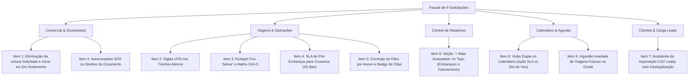

# Plano Arquitetural: Pacote de Evoluções e Melhorias Operacionais

> **Status:** Aguardando Aprovação do Usuário  
> **Origem:** Pacote de 9 Solicitações da Gestão  
> **Refinamento:** Alinhado integralmente via rodadas interativas de *Grill-me*  

---

## 1. Visão Geral e Objetivos

Este plano consolida as diretrizes técnicas e operacionais para a implementação do pacote de 9 melhorias solicitadas pela gestão da agência. Todas as definições foram refinadas para garantir zero regressão, conformidade estrita de banco de dados (PostgreSQL/Supabase) e preservação do padrão visual PaxFlow (h-[42px], rounded-xl, design tokens).



---

## 2. Detalhamento Técnico das 9 Entregas

### Item 1: Orçamentos Iniciando em "Em Andamento"
- **Regra de Negócio**: Como os consultores cadastram diretamente suas próprias cotações (sem fila prévia de triagem), a coluna `Solicitado` é removida da visualização principal do Kanban. Novos orçamentos passam a nascer com `status = 'EM_ANDAMENTO'`.
- **Métricas de SLA**: O cronômetro de primeiro atendimento é adaptado para medir o tempo decorrido da **criação da cotação até o envio formal da proposta** (`PROPOSTA_ENVIADA`).
- **Arquivos Afetados**: `src/pages/Orcamentos.ts`, `src/services/orcamentosService.ts`, `src/types/index.ts`.
- *Ponto de atenção anotado*: Aguardando esclarecimento da agência sobre o termo *"junção das telas"*.

---

### Item 2: Suporte a Siglas IATA em Viagens e Orçamentos
- **Regra de Negócio**:
  1. **Nos Trechos Aéreos de Viagens**: Campos `Origem` e `Destino` com autocomplete reativo baseado no catálogo IATA já existente no PaxFlow (ex: digitar `GRU` ➔ sugere `São Paulo - Guarulhos (GRU)`).
  2. **Flexibilidade Preservada**: Aceita tanto o código IATA de 3 letras quanto digitação livre de cidades sem aeroporto (destinos rodoviários, hotéis e portos).
  3. **No Destino de Orçamentos**: O campo de busca de destino passa a reconhecer siglas IATA (ex: digitar `MCO` preenche automaticamente `Orlando (MCO), Estados Unidos`).
- **Arquivos Afetados**: `src/components/dashboard/EditTravelModal.ts`, `src/pages/Orcamentos.ts`, `src/components/DestinosAutocomplete.ts`.

---

### Item 3: Rodapé Fixo (*Sticky Footer*) no Modal de Viagem
- **Regra de Negócio**: O botão `[ Salvar Alterações ]` e `[ Cancelar ]` deixa de ficar soterrado no final da aba "Dados Gerais". Ele passa a residir em uma barra inferior fixa (`sticky bottom-0 bg-white/95 backdrop-blur dark:bg-slate-900/95 border-t border-slate-100 dark:border-slate-800`), visível instantaneamente em qualquer rolagem.
- **Atalho Seguro**: Implementação do atalho `Ctrl + S` / `Cmd + S` com interrupção do evento do navegador (`e.preventDefault()`), ativado exclusivamente quando o modal estiver aberto em primeiro plano.
- **Arquivos Afetados**: `src/components/dashboard/EditTravelModal.ts`.

---

### Item 4: SLA de Pré-Embarque Diferenciado para Cruzeiros/Navio (20 Dias)
- **Regra de Negócio**:
  1. Criação do parâmetro `sla_cruzeiro_pre_embarque_dias INTEGER DEFAULT 20` na tabela `global_settings`.
  2. Interface de ajuste em *Configurações ➔ SLAs & Automações*.
  3. No motor do Inbox (`inboxService.ts`), quando a viagem possuir produto com categoria `cruzeiro`, `navio` ou `maritimo`, a janela de disparo do alerta é calculada com base neste parâmetro (padrão 20 dias), enquanto viagens aéreas convencionais seguem os 7 dias padrão.
  4. Formato de card enxuto mantido conforme solicitado.
- **Arquivos Afetados**: `supabase/schema.sql`, `src/pages/Configuracoes.ts`, `src/services/inboxService.ts`.

---

### Item 5: Correção do Filtro Avançado "Por Anexo" & Badge de Clipe
- **Diagnóstico Técnico**: O filtro avançado no `DashboardFilterEngine.ts` verificava `v.anexos_count`, porém a consulta principal de viagens em `Dashboard.ts` não trazia a agregação da tabela `documentos_anexos`.
- **Solução Arquitetural**:
  1. Realizar subconsulta agregada leve no carregamento do Dashboard (`documentos_anexos` indexada por `viagem_id`), computando `anexos_count` em memória sem transferir arquivos pesados.
  2. Ajustar o filtro para considerar "Com Anexo" viagens com `anexos_count > 0` OU com voucher emitido no produto.
  3. Inserir badge visual discreto com ícone de clipe (`📎`) na coluna Destino/Produtos quando houver anexos.
- **Arquivos Afetados**: `src/pages/Dashboard.ts`, `src/components/dashboard/ViagensTableView.ts`, `src/components/dashboard/DashboardFilterEngine.ts`.

---

### Item 6: Visão Dupla no Calendário (Ação Operacional vs. Data do Voo)
- **Regra de Negócio**: O calendário passa a adotar a **Visão Dupla Inteligente**:
  1. **Ação Operacional de SLA**: Na data correspondente à janela de SLA (ex: 7 dias antes para voos, 20 dias antes para cruzeiros), plota o card de tarefa `📞 Ação Pré-Embarque: [Cliente] - [Destino]`.
  2. **Data do Voo Real**: No dia em que a viagem de fato ocorre (`data_ida`), plota o card de evento `✈️ Embarque: [Cliente] - [Destino]`.
- **Arquivos Afetados**: `src/components/inbox/CalendarView.ts`, `src/services/inboxService.ts`.

---

### Item 7: Assistente de Carga em Lote: Clientes Leady (CSV)
- **Regra de Negócio**:
  1. Criação do botão e modal `📥 Importar Clientes (Leady CSV)` dentro do módulo de Clientes.
  2. Parser automático de colunas (Nome, CPF, Telefone, E-mail, Cidade, etc.).
  3. **Desduplicação Inteligente**: Verifica se o cliente já existe por CPF ou E-mail; se existir, atualiza dados cadastrais em branco sem gerar registros duplicados; se não existir, cria o novo cadastro.
  4. **Atribuição**: Clientes importados sem vínculo explícito são associados à carteira **"Geral / Agência"**.
- **Arquivos Afetados**: `src/pages/Clientes.ts`, `src/services/csvImporter.ts`, `src/services/clienteSearchService.ts`.
- *Ponto de atenção anotado*: Aguardando a exportação da planilha de clientes do Leady pelo usuário.

---

### Item 8: Seção "⭐ Mais Acessados" no Topo dos Relatórios & Permissões
- **Regra de Negócio**:
  1. Criação da seção nobre **"⭐ MAIS ACESSADOS"** fixada no topo da barra de navegação de relatórios, destacando com acesso direto em 1 clique:
     - 🛫 **Relatório de Embarques e Voos**
     - 💰 **Faturamento**
  2. Manutenção das categorias existentes (`Comercial`, `Financeiro`, `Operações`, `Equipe`) logo abaixo.
- **Arquivos Afetados**: `src/components/relatorios/shell/RelatoriosShellView.ts`.
- *Ponto de atenção anotado*: Aguardando a lista de relatórios restritos de vendas que o usuário colherá com a gestão.

---

### Item 9: Viagens Agendadas Imediatamente no Calendário
- **Regra de Negócio**:
  1. As viagens confirmadas passam a ser integradas à grade do Calendário **no mesmo instante em que forem cadastradas**, sem depender do disparo do alerta do Inbox.
  2. Se uma viagem para julho de 2027 for criada hoje, ao folhear o calendário até julho/2027 o card `✈️ Embarque: [Cliente] - [Destino]` e `🏠 Retorno: [Cliente]` já estará visível na grade.
  3. **Diferenciação Visual**:
     - *Viagem Futura (Agenda)*: Pílula azul/índigo suave `✈️ [Cliente] - [Destino]`;
     - *Ação Operacional (SLA)*: Pílula âmbar/verde `📞 Checklist Pré-Embarque`.
  4. **Filtro de Carteira**: Consultor visualiza apenas as viagens de sua responsabilidade; Administrador visualiza todas ou filtra por consultor.
- **Arquivos Afetados**: `src/pages/Inbox.ts`, `src/services/inboxService.ts`, `src/components/inbox/CalendarView.ts`.

---

## 3. Protocolo de Governança de Banco de Dados (DDL Supabase)

Para viabilizar o **Item 4** (configuração de dias para cruzeiro), o script SQL oficial abaixo deverá ser executado pelo usuário no Supabase SQL Editor:

```sql
-- 1. Adicionar coluna de SLA de cruzeiro na tabela global_settings se não existir
ALTER TABLE public.global_settings 
ADD COLUMN IF NOT EXISTS sla_cruzeiro_pre_embarque_dias INTEGER DEFAULT 20;

-- 2. Atualizar o registro existente com o valor padrão de 20 dias
UPDATE public.global_settings 
SET sla_cruzeiro_pre_embarque_dias = 20 
WHERE sla_cruzeiro_pre_embarque_dias IS NULL;
```

---

## 4. Fases de Execução Recomendadas

1. **Fase 1 (Ajustes Operacionais Imediatos de Alta Demanda)**:
   - Item 3: Rodapé fixo do botão Salvar e atalho `Ctrl+S`;
   - Item 5: Correção do filtro por anexo e badge de clipe;
   - Item 8: Seção "⭐ Mais Acessados" no topo dos relatórios (Embarques e Faturamento).
2. **Fase 2 (Calendário & Prazos Antecipados)**:
   - Item 4: Parâmetro e regra de pré-embarque de Cruzeiros (20 dias);
   - Item 6: Visão Dupla no Calendário (Ação operacional no SLA vs Embarque);
   - Item 9: Carga antecipada de viagens na grade do Calendário.
3. **Fase 3 (Comercial, IATA & Carga de Dados)**:
   - Item 1: Orçamentos iniciando em Em Andamento e SLA ajustado;
   - Item 2: Autocomplete IATA nos trechos da Viagem e destino de Orçamentos;
   - Item 7: Assistente de importação de clientes do Leady (quando o CSV for exportado).

---

## 5. Critérios de Aceite e Testes Subcutâneos
- **100% de Testes Subcutâneos**: Criação de suítes dedicadas para validação das regras de negócio do calendário, SLA de cruzeiros, filtro por anexos e desduplicação do Leady via Vitest.
- **Zero Regressão**: Manutenção dos 102 arquivos de teste (779 testes) 100% verdes.
- **Build Limpo**: Compilação `npm run build` com 0 erros de tipagem.
- **Documentação Sincronizada**: Atualização de `README.md`, `src/config/ajuda.ts` e `docs/documentation.md`.

