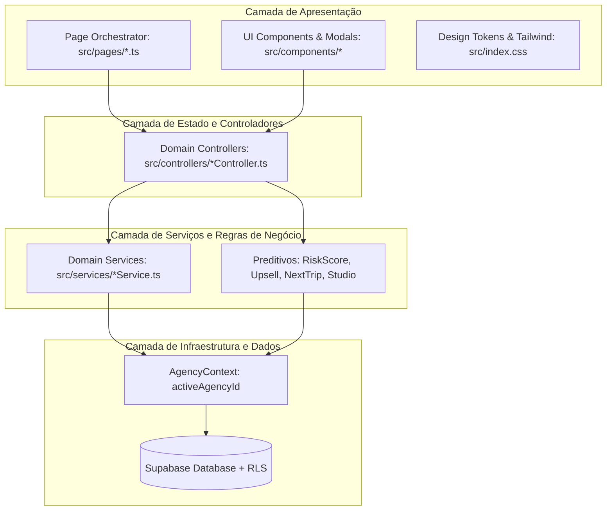

# Plano Mestre de Refatoração Arquitetural e Desacoplamento Modular v3.0

> **Status:** Documento Oficial de Planejamento Arquitetural (Atualizado em Outubro/2026)  
> **Escopo:** Mitigação de "God Files", Desacoplamento de Camadas (UI, Controllers, Services) e Preparação Multi-Tenant  
> **Safety Net Ativa:** 552 testes automatizados no Vitest (100% verde) + Build de Produção Vite

---

## 1. Visão Geral & Contexto da Evolução

O PaxFlow expandiu rapidamente de uma aplicação operacional básica para uma plataforma enterprise de gestão de agências de viagens, incorporando módulos avançados como **PaxFlow Studio (IA de Propostas)**, **Central de Relatórios Analíticos (17 visões)**, **PaxFlow Risk Score™ (Saúde Operacional)**, **Conciliação Bancária OFX/CSV**, **Esteira de Reembolsos Desacoplada** e **NextTrip Engine (Recompra Preditiva)**.

No entanto, o rápido crescimento gerou um fenômeno de concentração de código em **arquivos monolíticos ("God Files")** que ultrapassam 5.600 linhas em uma única página.

### Panorama Atual da Camada de Páginas (`src/pages/`):

| Página | Linhas Atuais | Severidade | Domínio Funcional Principal |
| :--- | :---: | :---: | :--- |
| [`Relatorios.ts`](file:///home/curupaco/Projetos/PaxFlow/src/pages/Relatorios.ts) | **5.609** | 🚨 Crítica | 17 abas analíticas, métricas de equipe, faturamento, embarque e NPS |
| [`Dashboard.ts`](file:///home/curupaco/Projetos/PaxFlow/src/pages/Dashboard.ts) | **4.703** | 🚨 Crítica | Matriz operacional de viagens, kanban, filtros múltiplos, drawer de risco |
| [`Orcamentos.ts`](file:///home/curupaco/Projetos/PaxFlow/src/pages/Orcamentos.ts) | **3.701** | 🚨 Crítica | Funil comercial, atendimento balcão, integração de propostas |
| [`Cadastros.ts`](file:///home/curupaco/Projetos/PaxFlow/src/pages/Cadastros.ts) | **3.254** | 🚨 Crítica | CRUDs de clientes, fornecedores, tipos de produto e formas de pagamento |
| [`Configuracoes.ts`](file:///home/curupaco/Projetos/PaxFlow/src/pages/Configuracoes.ts) | **2.670** | ⚠️ Alta | Perfis de consultores, regras de SLA, pontuações de risco, automações |
| [`LandingPageNova.ts`](file:///home/curupaco/Projetos/PaxFlow/src/pages/LandingPageNova.ts) | **2.388** | ⚠️ Alta | Apresentação institucional, checkout e conversão pública |
| [`StudioPage.ts`](file:///home/curupaco/Projetos/PaxFlow/src/pages/StudioPage.ts) | **2.291** | ⚠️ Alta | Extrator de roteiros por IA, gerador de propostas PDF/Web e Unsplash |
| [`Clientes.ts`](file:///home/curupaco/Projetos/PaxFlow/src/pages/Clientes.ts) | **1.894** | ⚠️ Média | Ficha 360°, histórico de compras, validação de passaportes |
| [`ComercialDashboard.ts`](file:///home/curupaco/Projetos/PaxFlow/src/pages/ComercialDashboard.ts) | **1.758** | ⚠️ Média | Metas de consultores, campanhas, comissionamento e divisões de vendas |
| [`LandingPage.ts`](file:///home/curupaco/Projetos/PaxFlow/src/pages/LandingPage.ts) | **1.425** | ℹ️ Baixa | Landing page legada (candidata a arquivamento/substituição) |
| [`Inbox.ts`](file:///home/curupaco/Projetos/PaxFlow/src/pages/Inbox.ts) | **1.410** | ⚠️ Média | Central de alertas operacionais, calendário de tarefas, chat realtime e escala |
| [`PublicViews.ts`](file:///home/curupaco/Projetos/PaxFlow/src/pages/PublicViews.ts) | **1.313** | ⚠️ Média | Visualização pública de propostas comerciais e pesquisa de satisfação NPS |
| [`Reembolsos.ts`](file:///home/curupaco/Projetos/PaxFlow/src/pages/Reembolsos.ts) | **1.003** | ⚠️ Média | Central financeira de tratativas de devolução e estornos |
| [`Conciliacao.ts`](file:///home/curupaco/Projetos/PaxFlow/src/pages/Conciliacao.ts) | **729** | ✅ Controlada | Conciliação bancária, extratos OFX/CSV e fechamento de mês |
| [`NextTripPage.ts`](file:///home/curupaco/Projetos/PaxFlow/src/pages/NextTripPage.ts) | **487** | ✅ Controlada | Matriz preditiva de recompra de viagens pós-retorno |
| [`Login.ts`](file:///home/curupaco/Projetos/PaxFlow/src/pages/Login.ts) | **302** | ✅ Otimizada | Autenticação e recuperação de credenciais |
| **Total em Páginas** | **~35.000** | — | **16 páginas orquestradoras** |

---

## 2. Diagnóstico Arquitetural: O Que Mudou da v2.0 para a v3.0?

A versão anterior deste plano (v2.0) sugeriu extrair blocos de estilo para dezenas de arquivos `.css` individuais (`inbox.css`, `orcamentos.css`, etc.). Na prática, o PaxFlow adotou com grande sucesso o **Tailwind CSS + Design Tokens PaxFlow** centralizados em `src/index.css`. Essa decisão eliminou a necessidade de arquivos CSS fragmentados, mantendo o estilo padronizado, seguro contra colisões e com suporte nativo a temas (Dark/Light).

Contudo, os verdadeiros gargalos de manutenção e consumo de tokens persistem nos seguintes pontos:

1. **Imports Diretos de `supabase` nas Páginas:** Embora já tenhamos criado 35 serviços e 8 controllers, 14 das 16 páginas ainda importam `supabase` diretamente, executando queries customizadas `supabase.from('...').select(...)` no meio do ciclo de renderização.
2. **Template Literals Maciços (> 2.000 linhas de HTML inline):** Telas como `Relatorios.ts` e `Dashboard.ts` constroem toda a interface através de concatenações gigantestas de HTML em template strings, misturando estrutura, formatação de moeda e lógica de eventos.
3. **Modais Embutidos no Corpo da Página:** Modais pesados (como `EditTravelModal`, `ViagemSplitEditor` ou diálogos de exportação) ainda possuem trechos de inicialização acoplados ao ciclo de vida da página receptora.
4. **Estado e Regras de Negócio na Camada de Visão:** Cálculos de comissionamento, agregação de faturamento e regras de triagem de status ainda são recalculados dentro dos métodos `render()` em vez de delegados aos controllers de domínio.

---

## 3. Diretrizes e Princípios Arquiteturais Invioláveis

De acordo com o **`AGENTS.md`** e as premissas de governança do PaxFlow, qualquer refatoração deve respeitar rigorosamente:

1. **Banco de Dados como Única Fonte da Verdade:** Proibição absoluta do uso de `localStorage` para estados de negócio, filtros persistidos ou mascaramento de dados. Conexão estável é mandatória.
2. **Resiliência a Schema Drift (Protocolo Zero-Break):** Qualquer consulta ou mutação deve suportar graciosamente eventuais discrepâncias de colunas (ex: fallback nativo para o erro SQL `42703`).
3. **Proteção Subcutânea Obrigatória (Safety Net):** Toda alteração de camada deve preservar a suíte de testes (Vitest) 100% verde (atualmente 552 testes em 69 arquivos).
4. **Design Tokens PaxFlow:** Seguir à risca os padrões de usabilidade:
   * Controles com altura padrão de **42px** (`h-[42px]`) com `items-end` em formulários.
   * Cantos arredondados: `rounded-2xl` / `rounded-3xl` para cards e `rounded-xl` para botões e inputs.
   * Cabeçalhos de tabelas: `sticky top-0 z-10/z-20 bg-slate-50 dark:bg-slate-950 shadow-xs` com rolagem vertical interna (`max-h-[600px]` ou `max-h-[650px]`).
   * Colunas de ação com largura travada (`w-28` ou `w-32`) e botões centralizados.
5. **Prontidão para Multi-Tenant (`AgencyContext`):** Serviços não devem assumir escopo global sem receber ou derivar o contexto de agência (`agencia_id`), conforme especificado em [`MultiTenant_Plano.md`](file:///home/curupaco/Projetos/PaxFlow/docs/MultiTenant_Plano.md).

---

## 4. Arquitetura Modular em Camadas (Vanilla TypeScript + Tailwind + Vite)

A arquitetura desacoplada organiza as responsabilidades em 4 camadas bem delimitadas:



### Regras de Interação entre Camadas:
* **Páginas (`src/pages/`)**: Atuam estritamente como **Orquestradores de Layout** e roteamento. Conectam os componentes visuais, registram atalhos de teclado e acionam os Controllers. **Zero imports de `supabase`**.
* **Componentes (`src/components/`)**: Recebem dados via propriedades/parâmetros e emitem eventos/callbacks. Cuidam do ciclo de vida de modais (`open()`, `close()`, `destroy()`).
* **Controladores (`src/controllers/`)**: Gerenciam o estado reativo da tela (filtros ativos, paginação, itens selecionados, ordenação) e traduzem intenções do usuário em chamadas de serviços.
* **Serviços (`src/services/`)**: Executam regras de negócio puras, transformações de DTOs, cálculos financeiros e chamadas de persistência no Supabase.

---

## 5. Cronograma Estratégico de Execução em 8 Fases

Para garantir estabilidade, zero tempo de indisponibilidade e economia de tokens, o cronograma é dividido em pacotes cirúrgicos e independentes:

### Fase 0: Baseline & Safety Net (Concluída ✅)
- **Status:** **100% Concluída.**
- **Entregáveis:** Suíte de 552 testes automatizados no Vitest executando em ~6s; pipeline de compilação de produção (`npm run build`) validado sem erros; design tokens auditados e documentados.

---

### Fase 1: Modularização da Central de Relatórios (`Relatorios.ts` — De 5.609 para < 500 linhas)
- **Objetivo:** Fracionar o maior "God File" do sistema em 4 submódulos especialistas dentro de `src/components/relatorios/`.
- **Estratégia de Execução Cirúrgica (4 Pacotes):**
  - **Pacote 1.1: Operações & SLAs (`embarques`, `prazos`, `posvenda`, `satisfacao`)** ✅ **CONCLUÍDO**
    - Extraído para `src/components/relatorios/operacoes/RelatoriosOperacoesView.ts` (1.189 linhas).
    - Desacopladas tabelas densas, filtros de embarque, badges de validação de gestor, modal de notas e exportação CSV.
    - `Relatorios.ts` enxugado de **5.609 para 4.453 linhas** (-1.156 linhas eliminadas no arquivo principal).
    - Validação: 100% dos 552 testes vitest verdes e build TypeScript/Vite impecável.
  - **Pacote 1.2: Financeiro & Auditoria (`faturamento`, `auditoria`, `perdas`)** ✅ **CONCLUÍDO**
    - Extraído para `src/components/relatorios/financeiro/RelatoriosFinanceiroView.ts` (902 linhas).
    - Desacoplados conciliação de faturamento/lucratividade, margens por produto, análise de perdas/desistências com SVG donut, auditoria de balcão e modal de extrato analítico de pagamentos.
    - `Relatorios.ts` enxugado de **4.453 para 3.660 linhas** (-793 linhas eliminadas neste pacote, total de **-1.949 linhas** acumuladas!).
    - Validação: 100% dos 552 testes vitest verdes e build TypeScript/Vite impecável.
  - **Pacote 1.3: Vendas & Performance Comercial (`desempenho`, `metas_campanhas`, `segmentacao_campanhas`)** ✅ **CONCLUÍDO**
    - Extraído para `src/components/relatorios/comercial/RelatoriosComercialView.ts` (1.257 linhas).
    - Desacoplados volume de vendas/lucro bruto funil, gráficos SVG de ranking por consultor, apuração temporal de metas/campanhas com premiação por faixas, popup modal de auditoria detalhada de metas, matriz de filtros de segmentação (NPS, sazonalidade, ticket e destinos) e integração Digisac.
    - `Relatorios.ts` enxugado de **3.660 para 2.463 linhas** (-1.197 linhas eliminadas neste pacote, total de **-3.146 linhas** acumuladas!).
    - Validação: 100% dos 552 testes vitest verdes e build de produção Vite concluído com código 0.
  - **Pacote 1.4: Orquestrador Enxuto & Finalização da Fase 1 (`previsoes`, `origens`, `gamificacao`, `riscopreditivo`, `shell`)** ✅ **CONCLUÍDO**
    - Extraído para `src/components/relatorios/inteligencia/RelatoriosInteligenciaView.ts` (1.028 linhas): previsões comerciais e pipeline ponderado, performance por canais de aquisição (origens), gamificação (hall da fama, rankings, badges e níveis) e painel preditivo de risco/churn.
    - Extraído para `src/components/relatorios/shell/RelatoriosShellView.ts` (260 linhas): header com exportação/impressão, barra de filtros globais e sidebar lateral com grupos colapsáveis e modo mini-bar.
    - Orquestrador principal `Relatorios.ts` desidratado com redução total de **-4.415 linhas** acumuladas (de 5.609 para 1.194 linhas mantendo estritamente funções de orquestração de estado e modais).
    - Validação: 100% dos 552 testes vitest verdes, tipagem 100% estrita sem erros de TypeScript e build Vite de produção bem-sucedido.
- **Status Geral da Fase 1:** **100% Concluída ✅**
- **Risco de Regressão:** Zero (blindado por `relatoriosController.test.ts`, `relatoriosMelhorias.test.ts` e `metasRelatorio.test.ts`).

---

### Fase 2: Decomposição do Dashboard Operacional (`Dashboard.ts` — 4.703 linhas)
- **Objetivo:** Extrair painéis de controle, kanban de viagens e filtros avançados do Dashboard.
- **Escopo de Decomposição:**
  - Extrair o painel de filtros superiores para `src/components/dashboard/DashboardFilterBar.ts`.
  - Isolar a tabela operacional de viagens e kanban em `src/components/dashboard/ViagensTable.ts` e `ViagensKanban.ts`.
  - Desacoplar totalmente a injeção do `EditTravelModal.ts` e `RiskDiagnosisDrawer.ts`.
- **Meta:** Reduzir `Dashboard.ts` para **< 600 linhas**.
- **Risco de Regressão:** Médio (coberto por `dashboardController.test.ts`, `dashboard_filtros_avancados.test.ts` e `viagensController.test.ts`).

---

### Fase 3: Desacoplamento de Orçamentos e Balcão (`Orcamentos.ts` — 3.701 linhas)
- **Objetivo:** Separar as visões de Funil de Vendas (Kanban/Lista), Modal de Novo Lead e Modal de Balcão.
- **Escopo de Decomposição:**
  - Extrair cards e colunas do Kanban de Orçamentos para `src/components/orcamentos/KanbanBoard.ts`.
  - Isolar o formulário rápido de atendimento balcão em `src/components/orcamentos/BalcaoQuickModal.ts`.
  - Mover operações de mutação de leads para `orcamentosController.ts` e `orcamentosService.ts`.
- **Meta:** Reduzir `Orcamentos.ts` para **< 500 linhas**.
- **Risco de Regressão:** Baixo (coberto por `orcamentosController.test.ts` e `orcamentosService.test.ts`).

---

### Fase 4: Modularização de Cadastros e Configurações (`Cadastros.ts` e `Configuracoes.ts`)
- **Objetivo:** Dividir os múltiplos formulários de tabelas auxiliares em abas isoladas.
- **Escopo de Decomposição:**
  - `Cadastros.ts` (3.254 linhas): Dividir em `ClientesTab.ts`, `FornecedoresTab.ts`, `ProdutosTab.ts` e `FormasRecebimentoTab.ts`.
  - `Configuracoes.ts` (2.670 linhas): Isolar abas de `AgenciaSettings.ts`, `EquipeSettings.ts`, `SlaSettings.ts` e `RiskScoreSettings.ts`.
- **Meta:** Reduzir cada arquivo de entrada para **< 400 linhas**.
- **Risco de Regressão:** Baixo (coberto por `cadastrosController.test.ts`).

---

### Fase 5: Isolamento do PaxFlow Studio & Propostas Editoriais (`StudioPage.ts` — 2.291 linhas)
- **Objetivo:** Desacoplar a interface visual do Studio dos motores de IA e geradores de templates.
- **Escopo de Decomposição:**
  - Extrair o extrator e parser de roteiro em `src/components/studio/StudioPromptEditor.ts`.
  - Isolar a pré-visualização da proposta editorial em `src/components/studio/StudioProposalPreview.ts`.
  - Eliminar o import direto de `supabase` em `StudioPage.ts`, utilizando exclusivamente `studioPropostasService.ts` e `studioExtractionService.ts`.
- **Meta:** Reduzir `StudioPage.ts` para **< 400 linhas**.
- **Risco de Regressão:** Médio (coberto por `studioPropostasService.test.ts` e `studioUiExperiencia.test.ts`).

---

### Fase 6: Erradicação Completa de Imports do Supabase em Páginas
- **Objetivo:** Cumprir o princípio arquitetural inviolável nº 1: **Zero chamadas Supabase diretas em `src/pages/`**.
- **Escopo de Execução:**
  - Auditar as 14 páginas que ainda realizam queries inline.
  - Redirecionar todas as consultas para a camada de Serviços correspondente (`inboxService.ts`, `viagensController.ts`, `clienteSearchService.ts`, `reembolsosService.ts`, etc.).
  - Padronizar tratamento de erros de rede via `errorTranslator.ts`.
- **Meta:** 0 ocorrências de `import { supabase } from '../services/supabase'` em `src/pages/`.
- **Risco de Regressão:** Baixo.

---

### Fase 7: Alinhamento Nativo com Multi-Tenant (`AgencyContext`)
- **Objetivo:** Conectar a camada de serviços e controllers ao contexto de agência reativo.
- **Escopo de Execução:**
  - Integrar `AgencyContext.ts` nos 35 serviços de `src/services/`.
  - Garantir injeção transparente de `agencia_id` nas consultas e mutações.
  - Implementar testes subcutâneos simulando isolamento entre diferentes agências.
- **Meta:** Compatibilidade total com o modelo de dados de [`MultiTenant_Plano.md`](file:///home/curupaco/Projetos/PaxFlow/docs/MultiTenant_Plano.md).
- **Risco de Regressão:** Médio (validação com testes negativos de acesso).

---

### Fase 8: Governança Contínua & Barreiras Anti-Regressão
- **Objetivo:** Estabelecer regras automáticas no repositório para evitar que novos arquivos monolíticos surjam.
- **Entregáveis:**
  - Script de verificação de limites no pré-build: alertar ou falhar se qualquer componente ultrapassar 800 linhas.
  - Regra de linter impedindo imports de `supabase` fora de `src/services/`.
  - Checklist obrigatório de PR/commit vinculado ao `AGENTS.md`.

---

## 6. Matriz de Priorização & Roadmap de Execução

```
Impacto na Manutenibilidade
  ▲
  │   [Fase 1: Relatórios]   [Fase 2: Dashboard]
  │        (5.609 linhas)         (4.703 linhas)
  │
  │   [Fase 3: Orçamentos]   [Fase 4: Cadastros]
  │        (3.701 linhas)         (3.254 linhas)
  │
  │   [Fase 5: Studio]       [Fase 6: Zero Supabase em Pages]
  │        (2.291 linhas)         (14 páginas)
  │
  │   [Fase 7: Multi-Tenant] [Fase 8: Barreiras Anti-Regressão]
  └─────────────────────────────────────────────────────────────► Esforço / Complexidade
```

---

## 7. Como Executar Cada Fase com o Assistente

Para iniciar a execução de qualquer fase:

1. Solicite explicitamente:  
   *Exemplo:* `"Antigravity, vamos executar a Fase 1 do refactoring_plan.md (Modularização do Relatorios.ts)"`.
2. O assistente seguirá o protocolo obrigatório:
   * **Mapeamento & Sub-componentes:** Criação dos módulos isolados em `src/components/`.
   * **Execução dos Testes Subcutâneos:** Validação imediata com `npx vitest run`.
   * **Verificação de Compilação:** Validação do bundle final com `npm run build`.
   * **Sincronização da Documentação:** Atualização contínua do `documentation.md` e do `ajuda.ts`.
